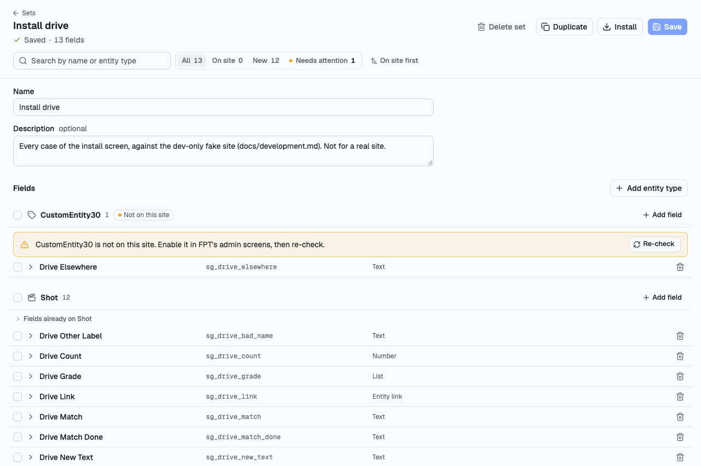
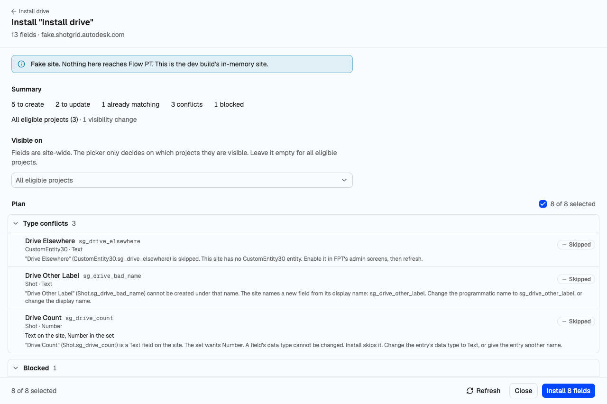
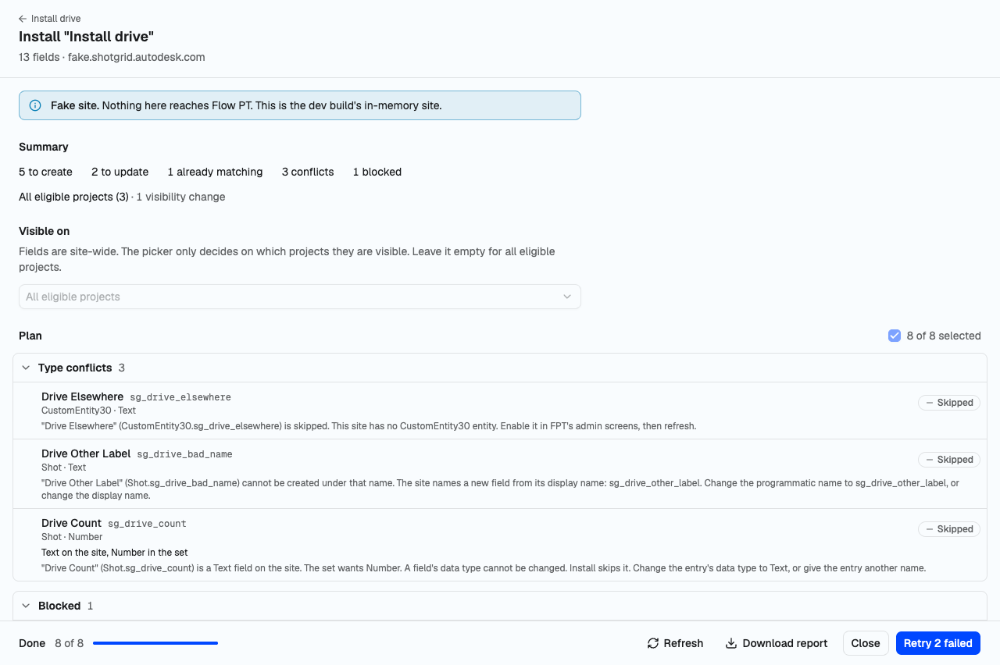

# sg-fields-setup

Field setup for Flow Production Tracking (FPT). Keep named sets of field definitions. Fill them from
spreadsheets or by hand. Compare them with a live site. Read the install plan. Install.

Built on [sg-widgets](https://github.com/ksallee/sg-widgets). API behaviour comes from
[sg-groundtruth](https://github.com/ksallee/sg-groundtruth).

## What it does

- Keeps sets: named, reusable lists of field definitions. They live in this browser. A set exports
  to a file and imports from one.
  The file carries the address of the site its fields were captured from, each captured field's
  schema record as the site sent it, and the names of the spreadsheets it was imported from. No
  token, no person.
- Fills a set from CSV or XLSX column headers, or by hand. Data rows are read only to guess a data
  type. No row is stored or sent.
- Shows, per field, whether it is on the connected site and whether it matches.
- Plans an install: what will be created, updated, left alone or refused, and why.
- Runs the install one field at a time, with progress, cancel, resume and retry.
- Sets on which projects the installed fields are visible.

Nothing is written to a site from a screen that has not shown the plan.

## What it does not do

- It does not create or enable entity types. Enable a custom entity in FPT first.
- It does not change a field's data type. The plan reports a conflict.
- It does not create calculated, query or summary fields. The API refuses them.
- It does not delete fields. A deleted field keeps its name taken.
- It does not empty the trash. It links to the site's trash page for fields.
- It does not hide a field that was there before the install.
- It has no undo. A run's report lists what was created.
- It has no server, no accounts and no LLM.

## Run it

    pnpm install
    pnpm dev

Open the URL Vite prints. Name your site and sign in. `docs/development.md` has the rest: the ports,
the dev token, the fake site, the sandbox and the deploy.

    pnpm check
    pnpm test
    pnpm build

## The four screens

**Connect.** Name the site. Sign in through the App Session Launcher. One site at a time. The token
stays in this browser.

**Sets.** The list of sets. Search, create, duplicate, delete. Import a spreadsheet or a set file.

**Editor.** One set, its fields grouped by entity type. Each field shows whether it is on the site.
Edit a field, or select several and change them together. One save.

**Install.** The plan, read fresh from the site: type conflicts, blocked, create, update, already
matches. Each refusal says why and what to do. Pick the projects the fields are visible on, or leave
the picker empty for all eligible projects.

Install asks once, then runs. A created field takes its name for good. A retired field under the
same name is revived when its type fits. When it does not, the row fails and links to the trash page.
Cancel stops after the step in flight. Resume and retry pick up from there. Refresh plans again:
every installed field then reads "already matches".

The install shots are of the dev build's fake site. See `docs/development.md`.

## More

- `specs/00-INDEX.md`: the requirements, file by file.
- `docs/design.md`: the look and the layout rules.
- `docs/development.md`: working on the app.
